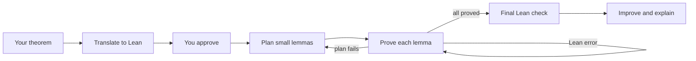

# Math Finder

[](https://github.com/pmehrotra3/math-finder/actions/workflows/ci.yml)
[](LICENSE)

**You write a theorem. Math Finder finds a proof, and Lean checks that it is correct.**

AI models can write convincing proofs that are wrong. Lean is a program that checks a proof step by step and rejects
any mistake. Math Finder combines them: the AI (Claude) has the ideas, and a proof counts only once Lean accepts it.

## An example

You type: *For every integer n, 6 divides n³ − n.*

| Step | What happened in a real run |
|---|---|
| 1. Translate | Claude writes it in Lean: `(n : ℤ) : 6 ∣ n ^ 3 - n`. You confirm that is what you meant. |
| 2. Plan | Claude suggests working with remainders modulo 6, and splits the proof into three small lemmas. |
| 3. Prove | Lean's automation proves the first lemma. Claude proves the other two. |
| 4. Check | Lean checks the complete proof. |
| 5. Improve | Claude tries shorter proofs. Lean accepts one with no helper lemmas. |
| 6. Explain | You get the Lean proof and an explanation in ordinary mathematics. |

## How it works



- **Translate:** the Lean version is translated back without seeing your original, then the two are compared.
- **Plan:** before proving any lemma, Lean checks that the lemmas together really imply the theorem.
- **Prove:** automatic tactics and a search for counterexamples come first. Claude is asked only if they fail, and it
  sees Lean's errors when it tries again. A lemma that stays stuck is split into smaller ones.
- **Check:** the final proof may contain no errors, no gaps (`sorry`), and only Lean's three standard axioms.
- **Work together:** in the web page you can give hints, suggest or reject lemmas, and answer its questions.

## Find your way around the code

Start with `pipeline.py`, then follow a theorem through `translation/`, `proving/` and `lean/`.

```
src/mathfinder/
├── pipeline.py          START HERE: one complete run, step by step
├── translation/         between people and Lean
│   ├── formalize.py       LaTeX → Lean statement
│   └── explain.py         Lean proof → explanation
├── proving/             finding the proof
│   ├── search.py          the main loop: plan, prove, check, try again
│   ├── planner.py         asks Claude for plans made of small lemmas
│   ├── prover.py          proves one lemma, repairing failed attempts
│   ├── hammer.py          automatic tactics and counterexamples, no AI
│   ├── optimize.py        looks for a better proof
│   └── session.py         your hints and answers during a search
├── lean/                checking the proof
│   ├── repl.py            keeps Lean running and sends it code
│   └── checker.py         the questions we ask Lean, and the final check
├── interface/           what you use
│   ├── cli.py             command line
│   ├── server.py          web server
│   └── web/               web page
├── llm.py               talks to Claude
└── benchmark.py         measures how many problems it solves

lean_env/                pinned versions of Lean, Mathlib and the REPL
bench/                   benchmark problems and results
tests/                   tests
```

## Setup

Requires [uv](https://docs.astral.sh/uv/), [elan](https://github.com/leanprover/elan), about 8 GB of disk for Mathlib,
and 16 GB of RAM or more (recommended).

```bash
git clone https://github.com/pmehrotra3/math-finder && cd math-finder
uv sync
cd lean_env && lake exe cache get && lake build repl && cd ..
```

The model is Claude, through the [`claude` CLI](https://claude.com/claude-code) by default.

| Variable | Default | Meaning |
|---|---|---|
| `MATHFINDER_LLM` | `cli` | `cli`, or `api` to use the Anthropic API |
| `ANTHROPIC_API_KEY` | | required for `api` |
| `MATHFINDER_CLI_MODEL` | CLI default | model for the `cli` backend |
| `MATHFINDER_LEAN_WORKERS` | `2` | Lean processes, each about 7.5 GB resident |
| `MATHFINDER_LEAN_RECYCLE` | `300` | checks before a Lean process restarts |

## Usage

```bash
uv run mathfinder serve                                               # web page at http://localhost:8000
uv run mathfinder prove 'For every integer $n$, $6 \mid n^3 - n$.'    # a theorem in LaTeX
uv run mathfinder prove --lean "(n : ℕ) : n + 0 = n"                  # a Lean statement
uv run mathfinder bench                                               # the benchmark
uv run pytest -m "not lean and not llm"                               # fast tests (no Lean, no model)
```

Each run is saved in `runs/` with a full trace. A proved theorem also gets its Lean proof and explanation.

## Results

20 of 20 proved on a [self-written set](bench/problems.jsonl) of competition-style problems, 8 of them by automation
alone ([per-problem results](bench/results.md), recorded before the REPL speedup). The set is small and fairly easy:
it is a regression test, not a miniF2F score.

Lean stays running with Mathlib loaded instead of restarting for each check. On one five-proof file that cut a check
from 2.78 s to 74 ms (medians).

## Limitations

- **Run it only for yourself.** Submitted Lean code is not sandboxed and there is no login or rate limiting, so do not
  expose the server to a network.
- Formalization can still miss the intended meaning, so read the Lean statement before approving it.
- The `api` backend has been tested only against a fake client.

## License

[MIT](LICENSE)
