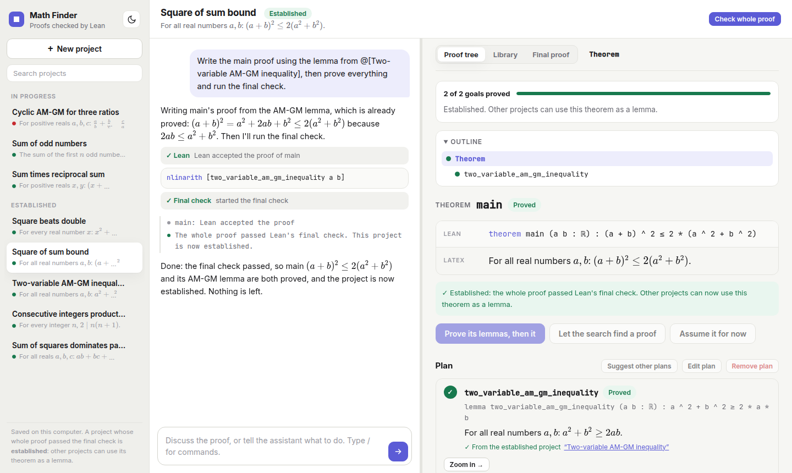
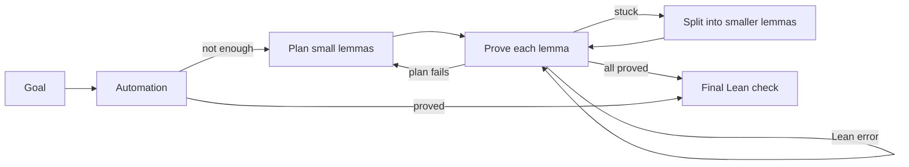

# Math Finder

[](https://github.com/pmehrotra3/math-finder/actions/workflows/ci.yml)
[](LICENSE)

**You write a theorem. Math Finder finds a proof, and Lean checks that it is correct.**



AI models can write convincing proofs that are wrong. Lean is a program that checks a proof step by step and rejects
any mistake. Math Finder combines them: the AI (Claude) has the ideas, and a proof counts only once Lean accepts it.

## Working with it

Math Finder works like a proof assistant sitting next to you.

1. **Write** the theorem in LaTeX, for example *for every integer n, 6 divides n³ − n*.
2. **Confirm** the Lean version. It is translated back into LaTeX without seeing your text, so you can check
   that it says what you meant.
3. **Plan and prove** in the workspace:
   - **Plan.** Ask for plans, or write your own. A plan is an idea, a list of lemmas, and a short Lean proof
     that combines them. Lean checks that the lemmas really imply the goal before anything is proved.
   - **Lean first, then LaTeX.** Every lemma is written in Lean, and its formal LaTeX is generated from that Lean,
     so the two always say the same thing. Edit any lemma, add or remove lemmas, or change the idea.
   - **Zoom in and out.** Open a lemma to give it a plan of its own, see every proof attempt with Lean's errors,
     or prove it on its own. The outline and the breadcrumb take you back out.
   - **Prove, search, or assume.** Prove a goal (its lemmas first), let the automatic search handle it, or
     assume a lemma for now and come back to it later.
   - **Ask on the side.** A side assistant answers questions about the proof at any time, without stopping or
     changing anything.
4. **Check and explain.** When the theorem is proved with nothing assumed, the whole tree goes through Lean's
   final check (no gaps, only standard axioms) and you get an explanation in ordinary mathematics.

### Projects

Every theorem is a **project**, saved on your computer, so you can keep many of them and come back later. A project
whose proof passed the final check is **established**: in any other project you can use its theorem as a lemma.
Lean still checks everything. The established project's verified code is included in the new proof, in a namespace
of its own, and the lemma is proved by applying that project's theorem. Projects that cite each other in a circle
are refused, and a project can't be deleted while another one cites it.

The command line (`mathfinder prove`) runs the same steps automatically, without the workspace or projects.

## How the automatic search works



Automatic tactics and a search for counterexamples come first. Claude is asked only when they fail, and it sees
Lean's errors when it tries again.

## Find your way around the code

Start with `pipeline.py`, then follow a theorem through `translation/`, `proving/` and `lean/`.

```
src/mathfinder/
├── pipeline.py          START HERE: one complete automatic run, step by step
├── translation/         between people and Lean
│   ├── formalize.py       LaTeX → Lean statement
│   └── explain.py         Lean proof → explanation
├── proving/             finding the proof
│   ├── workspace.py       the tree of goals you plan and prove together
│   ├── search.py          the automatic loop: plan, prove, check, try again
│   ├── planner.py         asks Claude for plans made of small lemmas
│   ├── prover.py          proves one lemma, repairing failed attempts
│   ├── hammer.py          automatic tactics and counterexamples, no AI
│   ├── optimize.py        looks for a better proof
│   └── session.py         lets you stop a running search
├── lean/                checking the proof
│   ├── repl.py            keeps Lean running and sends it code
│   └── checker.py         the questions we ask Lean, and the final check
├── interface/           what you use
│   ├── cli.py             command line
│   ├── server.py          web server
│   └── web/               web page
├── projects.py          saved projects, and the established results they share
├── benchmark/           the test problems, and how many it solves
├── assistant.py         the side assistant that answers your questions
└── llm.py               talks to Claude

lean/                    pinned versions of Lean, Mathlib and the REPL
tests/                   tests
runs/                    your projects and results (created when you run it; not in git)
```

## Setup

Requires [uv](https://docs.astral.sh/uv/), [elan](https://github.com/leanprover/elan), about 8 GB of disk for Mathlib,
and 16 GB of RAM or more (recommended).

```bash
git clone https://github.com/pmehrotra3/math-finder && cd math-finder
uv sync
cd lean && lake exe cache get && lake build repl && cd ..
```

The model is Claude, through the [`claude` CLI](https://claude.com/claude-code) by default.

| Variable | Default | Meaning |
|---|---|---|
| `MATHFINDER_LLM` | `cli` | `cli`, or `api` to use the Anthropic API |
| `ANTHROPIC_API_KEY` | | required for `api` |
| `MATHFINDER_CLI_MODEL` | CLI default | model for the `cli` backend |
| `MATHFINDER_LEAN_WORKERS` | `2` | Lean processes, each about 7.5 GB resident |
| `MATHFINDER_LEAN_RECYCLE` | `300` | checks before a Lean process restarts |

## Usage

```bash
uv run mathfinder serve                                               # the web page, at http://localhost:8000
uv run mathfinder prove 'For every integer $n$, $6 \mid n^3 - n$.'    # a theorem in LaTeX
uv run mathfinder prove --lean "(n : ℕ) : n + 0 = n"                  # a Lean statement
uv run mathfinder bench                                               # the benchmark
uv run pytest -m "not lean and not llm"                               # fast tests (no Lean, no model)
```

Each run is saved in `runs/` with a full trace. A proved theorem also gets its Lean proof and explanation.

## Results

20 of 20 proved on a [self-written set](src/mathfinder/benchmark/problems.jsonl) of competition-style problems, 8 of them by automation
alone ([per-problem results](src/mathfinder/benchmark/results.md), recorded before the REPL speedup). The set is small and fairly easy:
it is a regression test, not a miniF2F score.

Lean stays running with Mathlib loaded instead of restarting for each check. On one five-proof file that cut a check
from 2.78 s to 74 ms (medians).

## Limitations

- **Run it only for yourself.** Submitted Lean code is not sandboxed and there is no login or rate limiting, so do not
  expose the server to a network.
- Formalization can still miss the intended meaning, so read the Lean statement before approving it.
- The `api` backend has been tested only against a fake client.

## License

[MIT](LICENSE)
