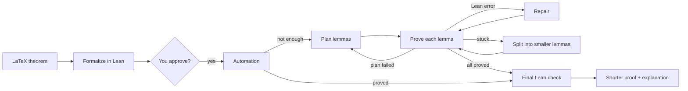

# Math Finder

[](https://github.com/pmehrotra3/math-finder/actions/workflows/ci.yml)

An automated reasoning system that turns a theorem written in LaTeX into a machine-checked Lean 4 proof.
A language model proposes the ideas; a proof counts only after Lean accepts it.

## How it works



- **Formalize:** the Lean statement is translated back to LaTeX without seeing the original, then compared with it.
- **Plan:** the model splits the theorem into small lemmas. Lean checks that they imply the theorem before any is proved.
- **Prove:** automatic tactics and a counterexample search run first. The model is asked only when they fail, and it
  sees Lean's errors when it repairs an attempt.
- **Check:** the final proof must have no errors, no `sorry`, and only Lean's three standard axioms.
- **Collaborate:** in the web page you can give hints, suggest or reject lemmas, and answer questions mid-search.

Lean runs in long-lived REPL processes that load Mathlib once. On one five-proof file this cut a check from
2.78 s to 74 ms (medians).

## Setup

Requires [uv](https://docs.astral.sh/uv/), [elan](https://github.com/leanprover/elan), about 8 GB of disk for Mathlib,
and 16 GB of RAM or more (recommended).

```bash
git clone https://github.com/pmehrotra3/math-finder && cd math-finder
uv sync
cd lean_env && lake exe cache get && lake build repl && cd ..
```

The model is Claude, through the [`claude` CLI](https://claude.com/claude-code) by default.

| Variable | Default | Meaning |
|---|---|---|
| `MATHFINDER_LLM` | `cli` | `cli`, or `api` to use the Anthropic API |
| `ANTHROPIC_API_KEY` | | required for `api` |
| `MATHFINDER_CLI_MODEL` | CLI default | model for the `cli` backend |
| `MATHFINDER_LEAN_WORKERS` | `2` | Lean processes, each about 7.5 GB resident |
| `MATHFINDER_LEAN_RECYCLE` | `300` | checks before a Lean process restarts |

## Usage

```bash
uv run uvicorn mathfinder.server:app                                  # web page at http://localhost:8000
uv run mathfinder prove 'For every integer $n$, $6 \mid n^3 - n$.'    # LaTeX
uv run mathfinder prove --lean "(n : ℕ) : n + 0 = n"                  # Lean statement
uv run mathfinder bench                                               # benchmark
uv run pytest -m "not lean and not llm"                               # fast tests (no Lean, no model)
```

Each run is saved in `runs/` with its Lean proof, explanation and full trace.

## Results

20 of 20 proved on a [self-written set](bench/problems.jsonl) of competition-style problems, 8 of them by automation
alone ([per-problem results](bench/results.md), recorded before the REPL speedup). The set is small and fairly easy:
it is a regression test, not a miniF2F score.

## Limitations

- **Run it only for yourself.** Submitted Lean code is not sandboxed and there is no login or rate limiting, so do not
  expose the server to a network.
- Formalization can still miss the intended meaning, so read the Lean statement before approving it.
- The `api` backend has been tested only against a fake client.

## Layout

| Path | Purpose |
|---|---|
| `mathfinder/search.py`, `planner.py`, `prover.py` | plan, prove, repair, decompose |
| `mathfinder/lean.py` | Lean REPL pool and the strict final check |
| `mathfinder/translate.py` | LaTeX → Lean, and proof → explanation |
| `mathfinder/optimize.py`, `pipeline.py` | proof polishing; one complete run |
| `mathfinder/server.py`, `collab.py`, `web/` | web server, live collaboration, page |
| `mathfinder/cli.py`, `bench.py`, `llm.py` | command line, benchmark, Claude backends |
| `lean_env/` | pinned Lean toolchain, Mathlib and REPL |
